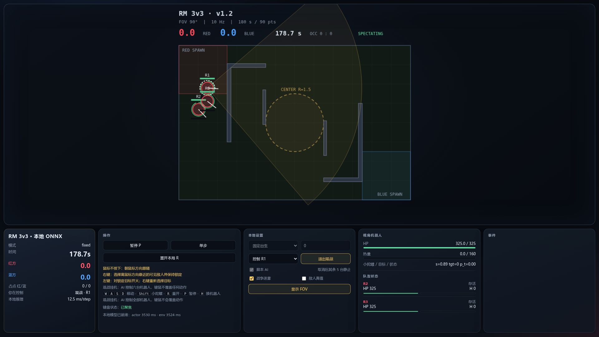
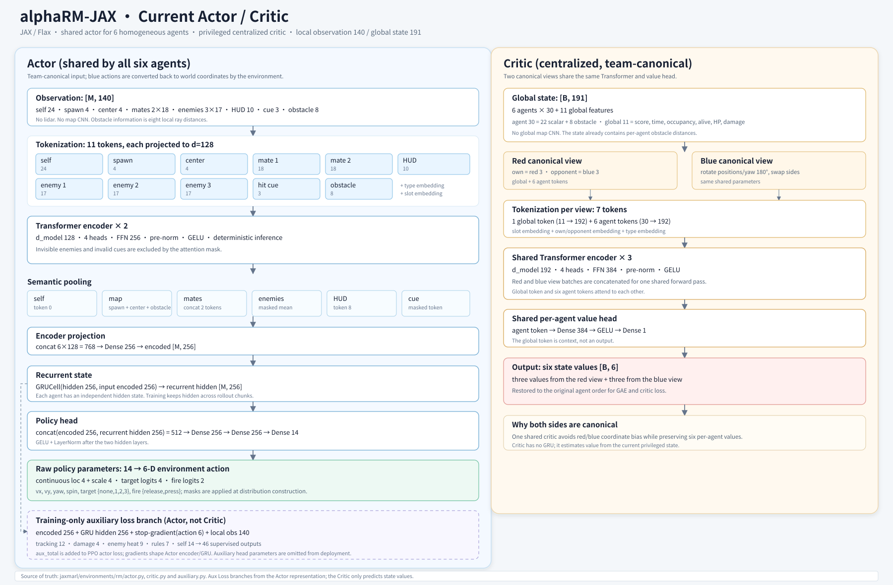
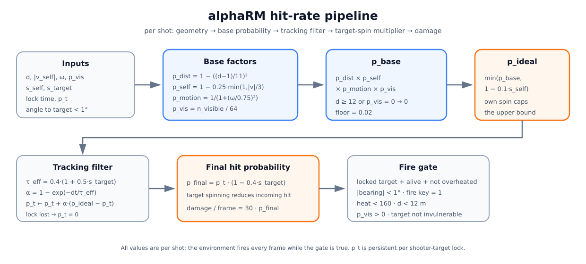
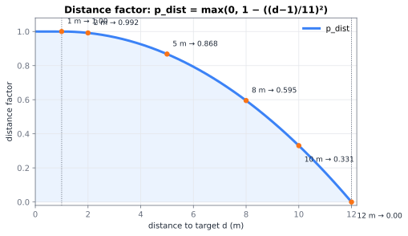
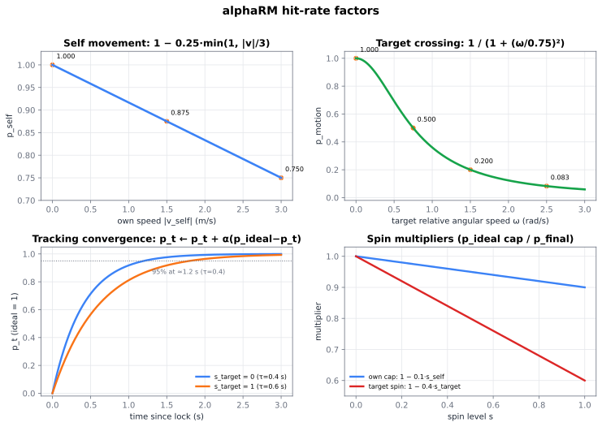
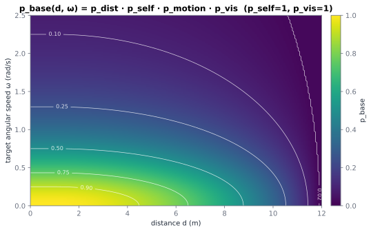
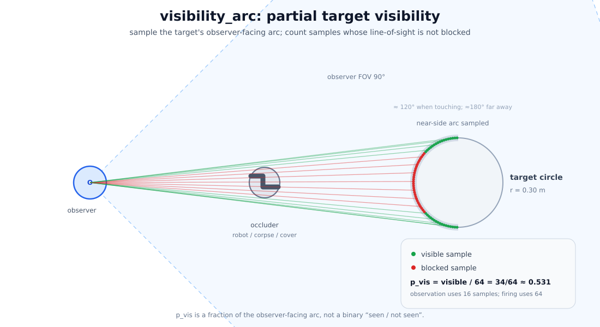

# alphaRM-JAX

**alphaRM-JAX** 是 [JaxMARL](https://github.com/bold-lab-ai/JaxMARL) 的 alphaRM 专用 fork，面向 RoboMaster 3v3 简化规则的 JAX/Flax 多智能体强化学习实现与浏览器演示。

当前仓库包含完整的 JAX 环境、MAPPO 训练、冻结最优对手联赛、自博弈、跨代评估、训练观察窗，以及可直接双击打开的人机大战 / AI 对战单文件演示。

> 上游基线：`JaxMARL` commit `3ba06c2`。上游通用说明保留在 [README_UPSTREAM.md](README_UPSTREAM.md)。

## 当前状态

- 最新训练产物：`outputs/rm_jax_league900_1200/jax_ckpt_001200.pkl`
- 当前联赛最优：`outputs/rm_jax_league900_1200/league_best.pkl`，iteration **1200**
- 最后训练配置：B=800、T=200、10 PPO epochs、bf16、`scan-all`、rollout lag=1
- 对手混合：75% 当前自博弈 + 25% 冻结最优代
- 辅助头：五类世界理解辅助预测，`aux_coef=0.02`
- 当前没有训练进程在运行

训练输出和 checkpoint 默认不进入 Git，使用 `.gitignore` 排除。



> 在线演示：https://captainkaz.github.io/alphaRM-JAX/  
> 默认六台 AI 自战；退出观战后接管当前机器人。

## 能做什么

| 模块 | 能力 |
|---|---|
| `jaxmarl/environments/rm` | JAX 版 RM 3v3 reset/step/observation/reward/mask/geometry |
| `baselines/MAPPO/train_rm_jax.py` | MAPPO 自博弈、冻结最优代联赛、辅助头、断点恢复 |
| `baselines/MAPPO/eval_rm_jax.py` | deterministic/stochastic 批量评测 |
| `liveview/` | 8768 训练观察窗、终局统计、得分曲线和输出文件浏览 |
| `human_jax_server.py` | JAX 后端的人机大战 HTTP 服务 |
| `docs/index.html` | 完全本地、模型内嵌的人机大战 / AI 观战演示，也是 Pages 首页 |
| `demo/web/` | ONNX 导出、ONNX Runtime Web、Worker、单文件构建源码 |

## 环境与网络

### 场地与比赛

- 场地：12 m × 8 m，`dt=0.1 s`
- 一局：180 s = 1800 步
- 每队 3 台同构机器人，先到 90 分
- 中心占点区半径 1.5 m
- 红方在 `-x` 侧，蓝方在 `+x` 侧

### 动作

每台机器人 6 维混合动作：

```text
[vx, vy, yaw, spin, target, fire]
```

- `vx, vy`：归一化底盘运动
- `yaw`：云台转向
- `spin`：小陀螺
- `target`：`0=无目标 / 1..3=敌方槽位`
- `fire`：`0=释放 / 1=开火`

`target` 和 `fire` 分别受 action mask 和 fire mask 约束；没有合法目标时不能开火。

### 观测与网络

- Actor 局部观测：**140 维**
- Actor tokens：**11 个**
- Actor：2 层 Transformer（d=128，4 heads，FFN=256）+ GRU(256) + 2×256 动作头
- Critic 全局状态：**191 维**
- Critic：红蓝两个 canonical 视角，3 层 Transformer（d=192，4 heads，FFN=384），共享 value head，输出 6 个 value
- 无 lidar、无地图 CNN；局部障碍信息是 8 向射线距离



> 当前图对应 JAX 代码：actor 11 tokens、GRU 输入 256 维 encoder；critic 是 3 层、d=192。

完整结构见 [docs/ARCHITECTURE.md](docs/ARCHITECTURE.md)。

## Auxiliary Loss：训练期世界理解

辅助头不是部署输出，而是给 Actor 的 encoder/GRU 增加可验证的表示学习信号。

输入：

```text
[GRU hidden 256, encoded 256, executed action 6, local obs 140]
```

五组预测：

| Head | 维度 | 学习内容 |
|---|---:|---|
| Tracking | 12 | 3 敌人的下一帧相对位移、不确定度、下一帧可见性 |
| Damage | 4 | 开火、条件命中率、伤害、击杀 |
| Enemy heat | 9 | 3 敌人的热量余量、一步热量变化、过热 |
| Rules | 7 | 占点、中心得分、击杀分、done |
| Self | 14 | 自身移动/转向、受伤、回血、冷却、过热、存活和无敌事件 |

位置预测使用**下一帧相对位移**，不是绝对世界坐标。敌人被遮挡后：

```text
age_weight = 0.5 × (1 + cos(pi × min(age / 15, 1)))
```

- 0 s：权重 1
- 0.75 s：权重 0.5
- 1.5 s：位置权重 0
- 1.5 s 后辅助头继续学习可见性和其他任务，只是不再追旧位置

总 loss：

```text
aux_total =
    1.00 × track
  + 1.00 × damage
  + 0.75 × heat
  + 0.75 × rules
  + 1.00 × self

actor_loss = PPO_loss + aux_coef × aux_total
```

最新 1200 轮使用 `aux_coef=0.02`，从 iteration 500 开始用 10 iter 线性升温。执行动作在辅助头输入前做 `stop_gradient`；league 中冻结对手通过 actor mask 排除。

特权状态只用于生成训练标签，不进入部署 Actor。辅助参数保存在 checkpoint 的 `aux_params` 中，但导出 ONNX/Web Actor 时不包含辅助头。

详细公式、指标和梯度边界见 [docs/AUX_LOSS.md](docs/AUX_LOSS.md)。

## 规则与设计摘要

完整规则见 [docs/RULES.md](docs/RULES.md)。规则书用于解释设计；实现数值以
`jaxmarl/environments/rm/config.py` 和 `env.py` 为准。

### 观测与信息不对称

| token | 内容 |
|---|---|
| self | 自身位置、速度、朝向、HP、热量、存活、目标、资源、8 向障碍距离 |
| spawn / center | 己方启动区与中心圈信息 |
| 2 × mate | 队友位置、速度、朝向、HP、热量、存活、复活倒计时 |
| 3 × enemy | 可见性、相对/绝对位置、速度、带噪 HP/朝向、开火、无敌、复活 |
| HUD | 双方比分、剩余时间、占点人数、队伍存活和总 HP |
| hit cue | 受击方向提示，带角度噪声 |
| obstacle | 独立 token，包含 8 向墙/掩体距离 |

不可见敌人和无效 cue 会被 attention mask 排除。队友信息共享；敌人信息受 FOV、
遮挡、距离和观测噪声限制。Actor 不读取全局地图或完整仿真状态。

### 动作与掩码

```text
[vx, vy, yaw, spin, target, fire]
```

- `target=0` 总是合法；敌人槽位要求存活、可见且在 12 m 锁定范围内。
- `fire=0` 总是合法；开火要求已有目标、射手存活、非无敌、未过热、热量未满且目标非无敌。
- 蓝方动作在环境内部做队伍 canonical 处理，输出动作再转换回世界系。

### 计分与终局

- 中心占点按红蓝净人数计分，每名净优势每帧贡献 `0.1` 分。
- 击杀 `+10` 分，先到 `90` 分立即结束。
- 时间到后依次比较比分、总伤害、存活总 HP。
- 10 s 无战斗/占点/回血事件触发空局。
- 碰撞、持续推墙和持续推人都有独立终局码。

| 终局码 | 含义 |
|---|---|
| 1 / 2 | 红/蓝先到目标分 |
| 3 / 4 | 红/蓝时间胜 |
| 5 / 6 | 红/蓝伤害 tiebreak |
| 7 / 8 | 红/蓝血量 tiebreak |
| 9 / 10 | 红/蓝因对方碰撞犯规获胜 |
| 20–22 | 时间 / 同帧 200 / 同帧犯规平局 |
| 23 | 10 s 无事件空局 |
| 24–26 | 推墙/掩体犯规：红胜 / 蓝胜 / 双方 |
| 27–29 | 推人犯规：红胜 / 蓝胜 / 双方 |

### 训练奖励

终局和 dense 奖励并存：

- 正常胜负包含基础胜负、剩余时间和分差项。
- 占点、命中/伤害、接近中心、存活和低血回家有 dense reward。
- 贴人、墙/掩体接触、持续推挤和高速冲击有连续惩罚。
- 最新 1200 轮训练关闭了**推人终局**（`--no-body-push-terminal`），但仍保留推人 dense 惩罚。
- 严格部署评测默认保留推墙/推人终局，因此训练目标和最终规则分布存在已知差异。

奖励系数以 `jaxmarl/environments/rm/config.py` 的 `k_*`、`terminal_*` 字段为准。

### 命中率模型

瞄准不等于必中。命中率由距离、自身移动、目标横穿、可见弧、命中率低通和目标小陀螺共同决定：

```text
p_base  = p_dist × p_self × p_motion × p_vis
p_ideal = min(p_base, 1 - 0.1 × s_self)
p_t     ← p_t + α × (p_ideal - p_t)
p_final = p_t × (1 - 0.4 × s_target)
damage/frame = 30 × p_final
```

其中：

```text
p_dist   = max(0, 1 - ((distance - 1) / 11)^2)
p_self   = 1 - 0.25 × min(1, |v_self| / 3)
p_motion = 1 / (1 + (ω / 0.75)^2)
```









> 曲线假设 `p_self = p_vis = 1`。实际开火还要求角度误差小于 1°、目标可见、
> 距离小于 12 m、未过热且 fire 指令为 1。

### 可见弧



可见性不是只测目标圆心，而是在目标圆朝向观察者的一侧采样：

- 观测/锁定：16 个采样点
- 开火/伤害：64 个采样点
- 绿色可见点比例即 `p_vis`
- `p_vis > 0` 即可锁定，但命中率会乘以 `p_vis`

所以目标只露出一部分时仍可攻击，只是命中概率更低。

## 安装

Python 3.11+。先根据硬件安装合适的 JAX，再安装本仓库：

```bash
pip install "jax[cuda13]"
# 或 CPU:
# pip install jax

pip install -e .[algs,dev]
```

验证环境：

```bash
python - <<'PY'
import jax
from jaxmarl import make

env = make("rm")
obs, state = env.reset(jax.random.PRNGKey(0), mode="fixed")
print(env.num_agents, obs[env.agents[0]].shape, state.pos.shape)
PY
```

### Docker

仓库提供 `Dockerfile.alphaRM`，不会安装 alphaRM 不需要的 Robotarium submodule：

```bash
docker build --build-arg UID="$(id -u)" \
  -t alphaRM-jax:latest \
  -f Dockerfile.alphaRM .

docker run --rm -it --gpus all --shm-size=20g \
  -v "$PWD":/workspace/alphaRM-JAX \
  alphaRM-jax:latest
```

需要 `perf` / `py-spy` 时给容器增加 `--privileged`。完整配方、CPU smoke、端口和 Dev Container 说明见
[docs/DOCKER.md](docs/DOCKER.md)。

## 快速开始

### 1. 单文件 AI 对战 / 人机大战

直接打开：

```text
docs/index.html
```

单 HTML 默认进入 **观战挂机**：六台机器人全部由 AI 控制。点击“退出观战”后接管当前所选机器人。

也可以本地启动静态服务：

```bash
python3 -m http.server 8080
# http://localhost:8080/docs/
```

详细操作、模型导出和单文件构建见 [demo/README.md](demo/README.md)。

GitHub Pages 直接发布 `main` 分支的 `/docs` 目录：

https://captainkaz.github.io/alphaRM-JAX/

部署说明见 [docs/GITHUB_PAGES.md](docs/GITHUB_PAGES.md)。

### 2. JAX 后端人机大战

```bash
PYTHONPATH=. python human_jax_server.py \
  --ckpt outputs/rm_jax_league900_1200/jax_ckpt_001200.pkl \
  --port 8767
```

打开 `http://localhost:8767/`。

### 3. 训练观察窗

```bash
bash liveview/start_rm_live.sh
```

- 主观察窗：`http://localhost:8768/`
- 统计页：`http://localhost:8768/stats.html`
- 输出文件：`http://localhost:8768/files`

训练时需要写入 live 数据：

```bash
python baselines/MAPPO/train_rm_jax.py \
  --live-view \
  --live-dir "$PWD/outputs/live" \
  ...
```

### 4. 训练

最小 smoke 示例：

```bash
PYTHONPATH=. python baselines/MAPPO/train_rm_jax.py \
  --B 16 --T 16 --updates 1 --epochs 1 \
  --disable-jit --no-log
```

当前 1200 轮配方的完整参数、恢复命令和评估口径见
[docs/TRAINING_AND_EVALUATION.md](docs/TRAINING_AND_EVALUATION.md)。

### 5. 评测

```bash
PYTHONPATH=. python baselines/MAPPO/eval_rm_jax.py \
  --ckpt outputs/rm_jax_league900_1200/jax_ckpt_001200.pkl \
  --episodes 8 --seed 0 --mode fixed \
  --out outputs/eval_1200
```

## 仓库结构

```text
alphaRM-JAX/
├── jaxmarl/environments/rm/       # RM 配置、环境、actor、critic、辅助头
├── baselines/MAPPO/               # JAX MAPPO、联赛、日志、评测
├── parity/                        # Torch/JAX 对拍、转换和性能分析
├── liveview/                      # 8768 训练观察窗
├── demo/
│   ├── human_game.html            # JAX HTTP 人机大战前端
│   └── web/                       # ONNX 导出、Worker、构建源码和资产
├── docs/                          # Pages 单文件入口、架构、规则和训练文档
├── human_jax_server.py            # JAX 人机大战服务
├── CONTRIBUTING.md                # 提交规范、测试和评审要求
└── README_UPSTREAM.md             # 上游 JaxMARL README
```

## 当前验证边界

- 固定 reset、普通移动、dense reward、global state、actor/critic 已做 Torch/JAX 对拍。
- 碰撞/推挤后的物理残差、random reset 的 RNG 序列和观测噪声仍可能存在统计或样本级差异。
- 最新训练关闭了推人终局（`--no-body-push-terminal`），保留 dense 推人惩罚；评测时必须写清是否关闭推人/推墙终局。
- `league_eval.json` 中的红蓝胜率仍有明显不对称，不能只用总胜率推断真实强度。
- 当前 actor 不接收全局地图；多地图泛化不在已实现范围内。

详细实现与历史差异见：

- [docs/RULES.md](docs/RULES.md)：权威简化规则
- [docs/IMPLEMENTATION_NOTES.md](docs/IMPLEMENTATION_NOTES.md)：JAX 实现口径与已知差异
- [docs/TORCH_IMPLEMENTATION_NOTES.md](docs/TORCH_IMPLEMENTATION_NOTES.md)：从 PyTorch 仓库带入的参考说明

## 测试

```bash
python -m compileall jaxmarl/environments/rm baselines/MAPPO liveview human_jax_server.py
python parity/test_ppo_math.py
# 安装 dev 依赖后也可以使用 pytest
python -m pytest parity/test_ppo_math.py -q
```

提交前要求见 [CONTRIBUTING.md](CONTRIBUTING.md)，提交信息采用 Conventional Commits。

## 上游与许可

本项目基于 Apache-2.0 许可的 JaxMARL。上游归属、引用信息和 fork 基线见
[docs/UPSTREAM.md](docs/UPSTREAM.md)，许可证保留在 [LICENSE](LICENSE)。

如果使用 JaxMARL 的环境或基础设施，请同时引用上游 JaxMARL 论文，引用格式见
[README_UPSTREAM.md](README_UPSTREAM.md)。
