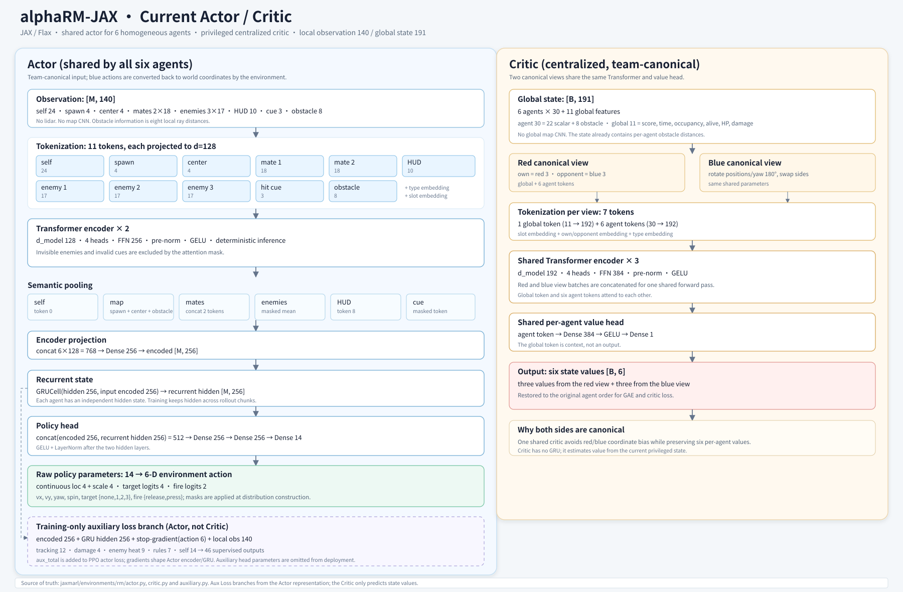

# 架构与代码地图

本文描述当前仓库实际实现，不以历史设计文档为准。

## 1. 代码分层

| 层 | 文件 | 职责 |
|---|---|---|
| 规则常量 | `jaxmarl/environments/rm/config.py` | 场地、动作、武器、热量、复活、奖励、RSI、联赛默认参数 |
| JAX 环境 | `jaxmarl/environments/rm/env.py` | reset、step、几何、碰撞、目标、命中、热量、死亡、奖励、观测和 critic state |
| Actor | `jaxmarl/environments/rm/actor.py` | 实体 Transformer、GRU、连续/离散动作分布和 mask |
| Critic | `jaxmarl/environments/rm/critic.py` | 队视角 canonical 191 维全局状态和共享 value head |
| 辅助头 | `jaxmarl/environments/rm/auxiliary.py` | 训练期世界理解监督与监控指标 |
| PPO/联赛 | `baselines/MAPPO/train_rm_jax.py` | rollout、GAE、PPO、辅助 loss、冻结最优代和 checkpoint |
| 观察窗 | `liveview/` | 8768 回放、统计和输出浏览 |
| 人机/观战 | `human_jax_server.py`、`demo/` | JAX HTTP 人机大战和全本地 ONNX Web 演示 |

注册入口：

```python
from jaxmarl import make
env = make("rm")
```

## 2. 环境状态

核心状态是 `RmState`。常用字段：

| 字段 | 形状 | 含义 |
|---|---|---|
| `pos` | `[6,2]` | 世界坐标 |
| `yaw` | `[6]` | 云台角 |
| `vel`, `v_pre` | `[6,2]` | 当前/预接触速度 |
| `hp`, `heat` | `[6]` | 血量、热量 |
| `overheated`, `alive` | `[6]` | 过热、存活 |
| `invuln`, `invuln_timer` | `[6]` | 无敌状态和时间 |
| `respawn_timer` | `[6]` | 复活倒计时 |
| `target`, `target_cmd` | `[6]` | 当前/请求目标 |
| `fire_cmd`, `last_fired` | `[6]` | 开火指令和本帧开火 |
| `p_t`, `last_p_final` | `[6]` | 命中率低通和最终概率 |
| `score`, `time`, `occ` | 标量或 `[2]` | 比分、剩余时间、占点人数 |
| `outcome`, `winner`, `done` | 标量 | 终局码、赢家和结束标志 |

训练检查点和 ONNX 环境图都依赖状态叶子的 flatten 顺序。修改 dataclass 字段顺序会使旧 checkpoint 或旧 ONNX 图不兼容。

## 3. Actor

### 输入

Actor 输入 `[M,140]`：

```text
self 24
+ spawn 4
+ center 4
+ 2 mates × 18
+ 3 enemies × 17
+ cue 3
+ HUD 10
+ obstacle 8
= 140
```

### Token 化

当前实现为 **11 个 token**：

1. self
2. spawn
3. center
4. mate 1
5. mate 2
6-8. enemy 1-3
9. HUD
10. hit cue
11. obstacle/world

每个 token 投影到 128 维，并加入类型和槽位 embedding。

### Encoder 与 recurrent head

- 2 层 pre-norm Transformer
- 4 attention heads
- FFN 256
- 不可见敌人和无效 cue 通过 attention mask 排除
- 语义池化后得到 256 维 encoder 输出
- `concat(hidden, encoded)` 进入 GRU(256)
- GRU 后接 2×256 MLP，输出 14 个 raw 参数：
  - 4 个连续动作 `loc`
  - 4 个连续动作 `scale`
  - 4 个 target logits
  - 2 个 fire logits

部署推理只需要 `RmActor`；辅助头不进入 actor 推理图。



## 4. Critic

Critic 输入 `[B,191]`：

```text
6 agents × 30
+ 11 global features
= 191
```

每台 agent 的 30 维由 22 个标量、3 个对敌累计伤害和 8 向障碍距离组成。

当前 critic：

- 构造红、蓝两个 canonical 视角
- 每个视角为 global token + 6 agent tokens
- 3 层 Transformer
- `d_model=192`
- 4 heads
- FFN 384
- 两个视角共享参数和 value head
- 输出现有 6 台机器人在原始 agent 顺序下的 value

> 旧交接文档曾写 critic 为 2 层；当前代码为 3 层，以此处和 `critic.py` 为准。

## 5. 辅助预测头

辅助头是训练期表示学习模块，不修改部署 actor 的输入，也不向 actor 提供特权信息。

输入：

```text
[GRU hidden 256, encoder 256, executed action 6, current obs 140]
```

五类输出：

| 头 | 维度 | 目标 |
|---|---:|---|
| tracking | 12 | 3 个敌人 × `(dx, dy, log_sigma, visible_next)` |
| damage | 4 | 开火、条件命中率、期望伤害、击杀 |
| enemy heat | 9 | 3 个敌人 × `(heat margin, heat delta, overheated)` |
| rules | 7 | 占点、中心得分、击杀分、done 等规则量 |
| self | 14 | 自身运动、资源、存活/无敌/过热等事件 |

合计 46 维输出。

位置 label 使用队伍 canonical 的当前敌人相对位置和下一帧相对位移，归一化尺度是 `2 × v_max × dt = 0.6 m`。追踪目标在敌人被遮挡后最多保留 15 步（1.5 s），监督权重随遮挡年龄平滑衰减；每个训练样本的位置 loss 权重在 1.5 s 内降到 0。辅助头仍然继续训练，只是旧锚点不再贡献位置 loss。

联赛训练中，冻结对手不参与 actor 辅助 loss，避免特权标签通过共享 actor 参数影响非学习者一侧。

## 6. PPO 与联赛

训练 rollout 形状为：

```text
T × B × 6
```

主要步骤：

1. 从当前 state 获得 action/fire masks
2. 从共享 actor 采样 6 台动作
3. 环境 step
4. 计算 reward、terminated/truncated 和 GAE
5. 按 minibatch 执行 PPO epochs
6. 可选计算辅助 loss
7. 写 CSV、live JSON 和 checkpoint

`done` 表示环境 episode 结束，`terminated` 表示不再 bootstrap；截断或非终止 done 使用终局前 critic value。GAE 在所有 `done` 上断开，但只有 `terminated` 清除 bootstrap。

联赛模式：

- 默认 75% 环境槽位为当前 actor 自博弈
- 25% 对冻结最优代
- 冻结对手不反传 learner 梯度
- 周期性在当前自博弈和固定 base 上评估
- 达到胜率/分差门槛后更新 `league_best.pkl`

## 7. 观察窗与演示

### JAX 观察窗

训练进程通过 `write_rm_live()` 写：

```text
outputs/live/rm_live.json
```

`liveview/serve_rm_live.py` 只读 `outputs/`，提供：

- 逐帧片段
- 全 batch 终局码统计
- 每 iter 得分增量
- checkpoint、视频、日志文件浏览

### 单文件 Web 演示

`docs/index.html` 的运行时结构：

```text
Canvas UI
  ↕ postMessage
Classic Blob Worker
  ├─ ORT Web WASM
  ├─ actor_1200.onnx
  ├─ env_step.onnx
  └─ fixture.json
```

模型和 WASM 均内嵌到 HTML。Worker 运行环境和策略，主线程只处理输入与绘制。

默认启用 AI 观战；退出观战后，当前视角机器人由键鼠覆盖，其余仍由 AI 驱动。

## 8. 真相来源

发生文档冲突时按以下顺序：

1. 当前代码和 `RmConfig`
2. 保存的训练 `hparams.json`
3. 当前实现说明
4. 简化规则书
5. 历史交接文档
